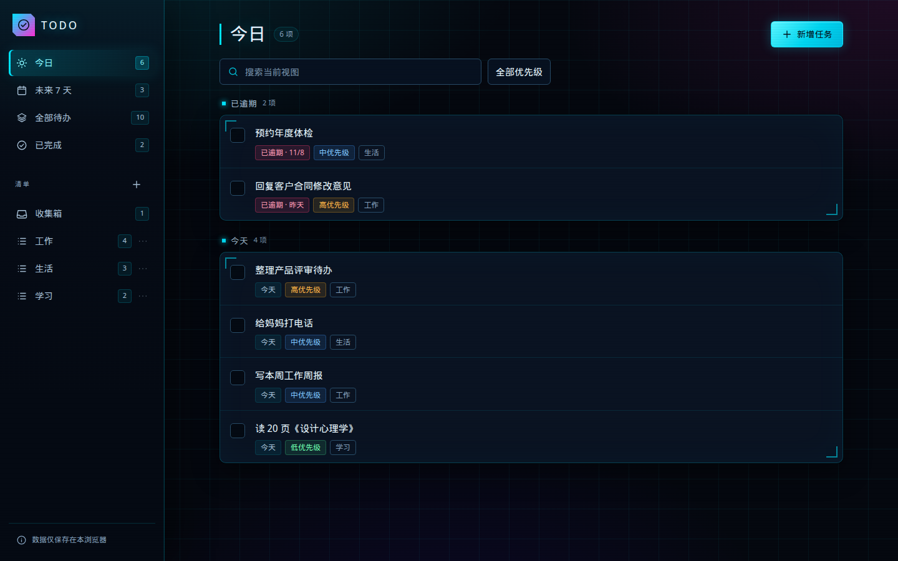
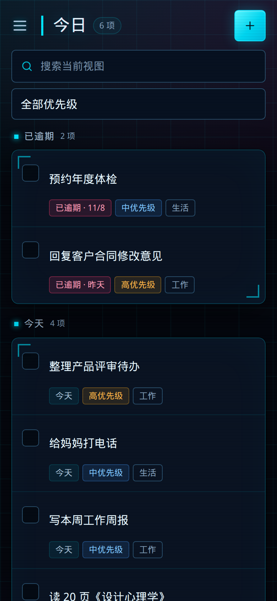

# Todo

按《Todo 产品需求文档（PRD）v1.0》实现的响应式个人待办 Web 应用。打开即用，无需登录；任务和清单只保存在当前浏览器的 `localStorage`，不会上传到服务器。

首版覆盖 PRD 的 P0 范围：任务新增、查看、编辑、完成、重新打开和删除；收集箱与自定义清单；今日、未来 7 天、全部待办、已完成及清单视图；当前视图搜索与优先级筛选；本地持久化、多标签页冲突检测、数据损坏处理和响应式交互。

## 本地运行

要求 Node.js ≥ 20.19（已在 Node 22.22 上验证）。

```bash
npm install
npm run dev
# 打开 http://127.0.0.1:4173/
```

## 构建与部署

```bash
npm run build
npm run preview   # 本地预览 dist/
```

`dist/` 是纯静态产物，可部署到任意支持 HTTPS 的静态托管（Nginx、对象存储、GitHub Pages 等）。应用只有一个入口 `index.html`，没有后端接口和运行时外部依赖。部署时建议：

- 全站使用 HTTPS；
- 将 `dist/` 原样发布；
- 如需为深层路径配置回退，将未知路径回退到 `index.html`（当前版本没有前端路由，直接访问根路径即可）。

## 脚本

| 命令 | 说明 |
| --- | --- |
| `npm run dev` | 启动 Vite 开发服务器 |
| `npm run build` | 类型检查并生成 `dist/` |
| `npm run preview` | 预览生产构建 |
| `npm run typecheck` | TypeScript 类型检查 |
| `npm test` | Vitest 单元测试 |
| `npm run test:e2e` | Playwright 端到端测试（需先安装浏览器） |
| `npm run screenshots` | 用 Playwright 重新生成 `docs/screenshots/`（需先启动构建预览） |

端到端测试首次运行需要安装浏览器：

```bash
npx playwright install chromium
# 如系统缺少运行库，按 Playwright 提示安装系统依赖
```

Linux 无桌面环境如果只缺少数运行库，也可以把依赖包解压到本地目录后通过 `LD_LIBRARY_PATH` 运行；本仓库不包含系统库。

## 数据

- 存储键：`todo.app.v1`
- 数据格式版本：`1`
- 字段、并发控制与异常处理：见 [docs/DATA.md](docs/DATA.md)

清除浏览器站点数据、更换浏览器或设备、或使用无痕模式后，数据不会自动恢复。首版没有账号、云同步和回收站。

## 测试与验收

- 单元测试覆盖日期、字符计数、校验、排序、视图归属、搜索筛选和存储格式。
- 端到端测试覆盖 PRD 的 AC01–AC20 主要流程，包括多标签页冲突、写入失败、数据损坏、跨午夜刷新和移动端布局。
- 验收环境、结果、性能数据和限制：见 [docs/ACCEPTANCE.md](docs/ACCEPTANCE.md)。

## 界面

桌面使用侧边导航 + 侧面板详情；手机使用可展开导航 + 全屏详情。界面采用暗色赛博朋克主题：网格与扫描线背景、霓虹青/品红强调色、等宽字体计数与发光焦点态；布局和交互保持不变。截图与交互说明见 [docs/UI.md](docs/UI.md)。

| 桌面 | 手机 |
| --- | --- |
|  |  |

## 已知限制

- 真实 Safari、Edge、iPhone Safari 和 Android Chrome 设备未在本环境执行；自动化用例运行于 Playwright Chromium。详见验收记录。
- 日期输入框的原生展示格式由浏览器区域设置决定；应用内部始终以 `YYYY-MM-DD` 保存日期。
- 首版不包含 P1 能力（账号同步、提醒、重复任务、子任务、标签、导入导出、回收站、主题切换等）。
