# 界面与交互稿

## 基线

- 基线提交：`a52803b`（`main`）。
- 基线状态：仓库只有 `README.md`，没有应用入口、构建配置或任何页面，因此没有可比较的旧版 UI。
- 下图是该基线提交作为静态站点打开时的实际画面（仅 README 文件，无应用）。

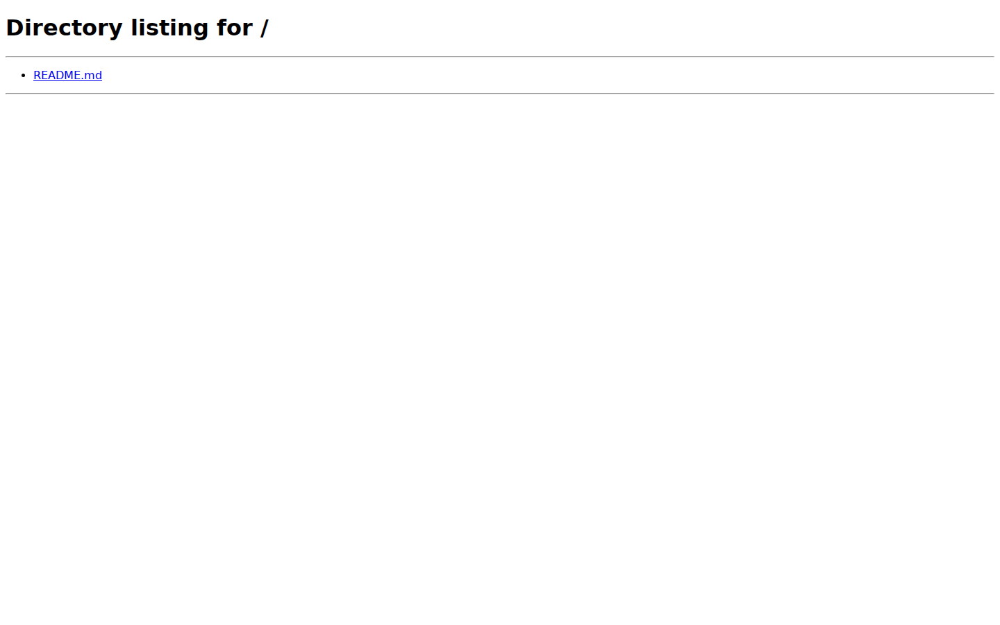

## 首版界面

### 桌面

| 画面 | 截图 |
| --- | --- |
| 今日视图：逾期/今日分组、清单与优先级、导航数量 | 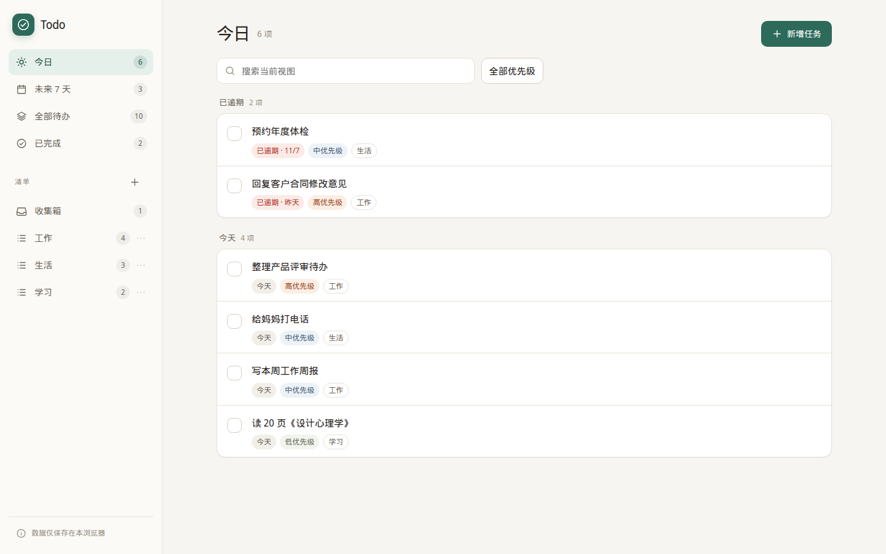 |
| 任务详情：标题、备注、日期、清单、优先级、删除 | 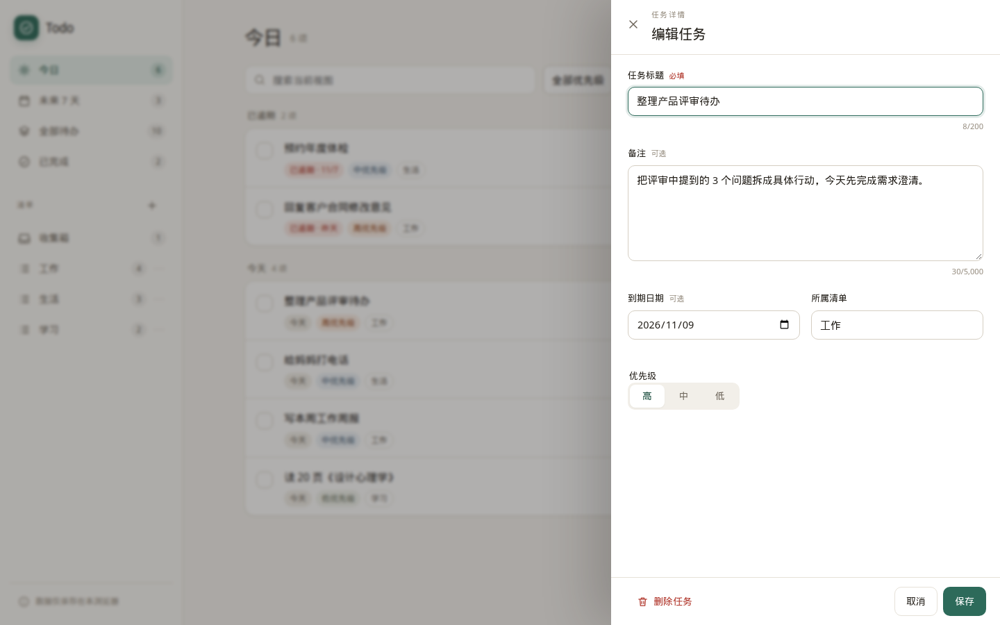 |
| 新建清单 | 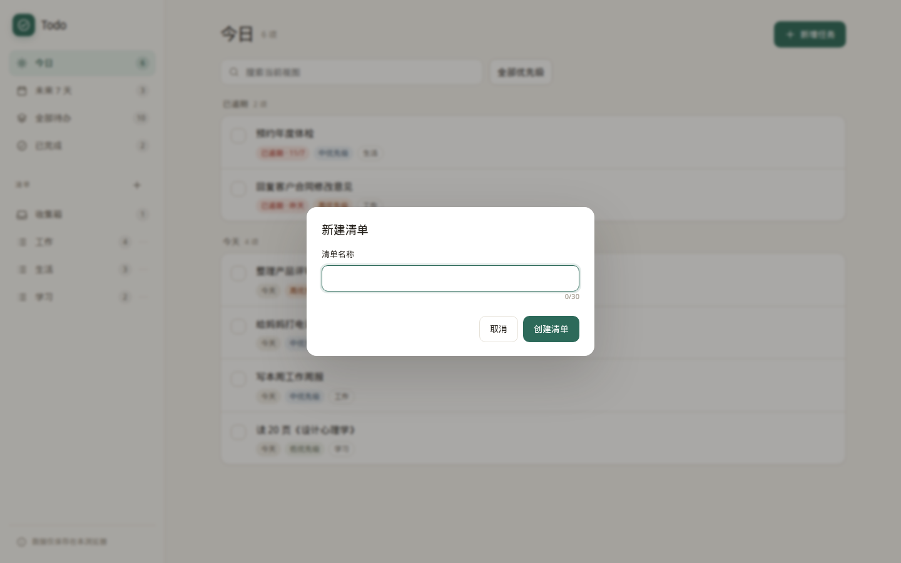 |
| 已完成视图：完成标记、标题删除线、完成时间排序 | 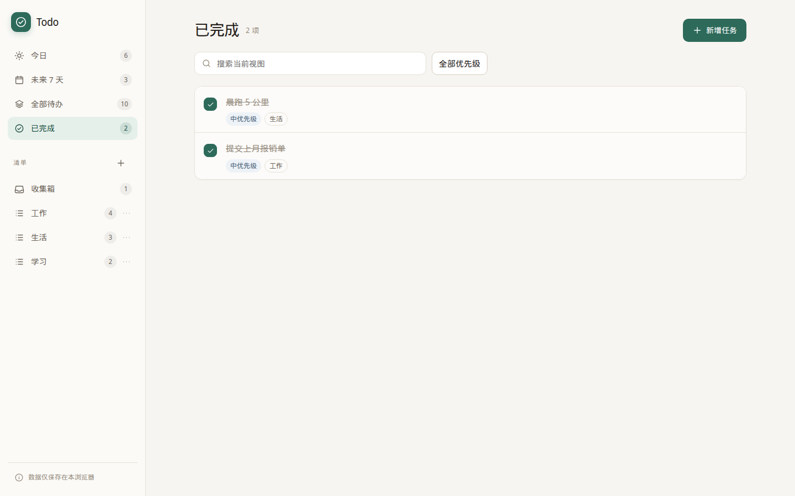 |
| 数据说明 | 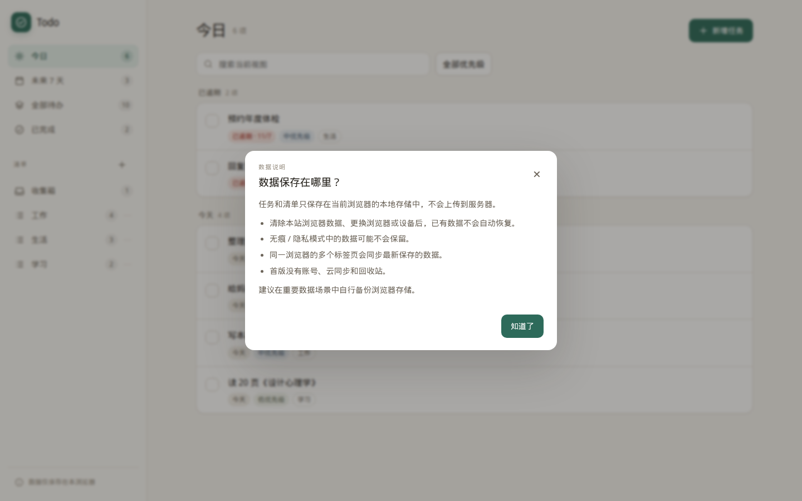 |
| 首次使用空状态 | 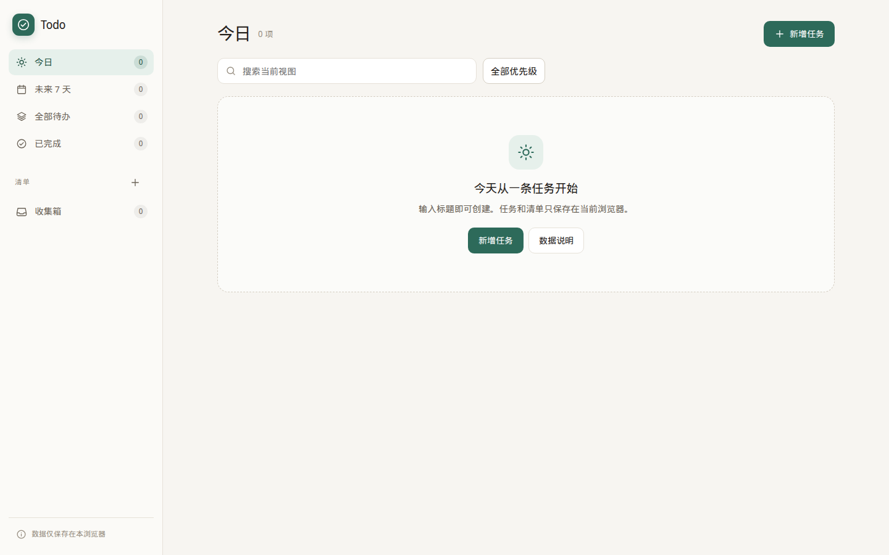 |
| 数据损坏状态 | 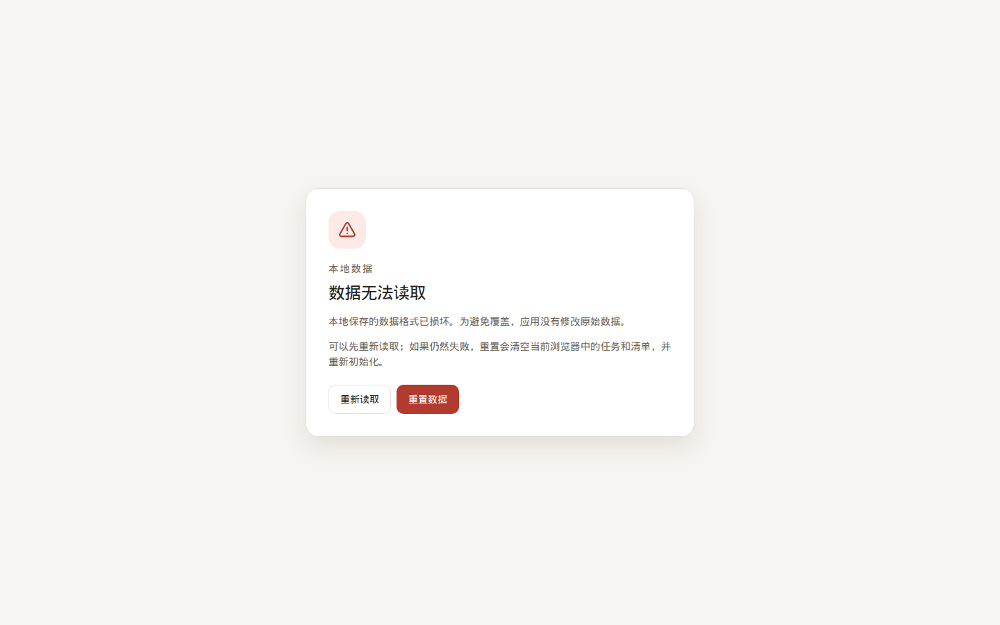 |

### 手机（390 × 844）

| 画面 | 截图 |
| --- | --- |
| 今日视图 | 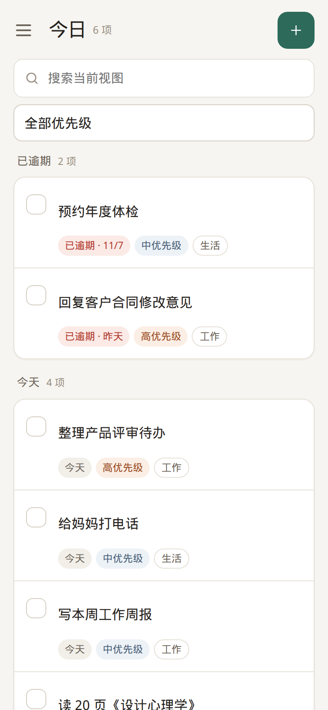 |
| 可展开导航 | 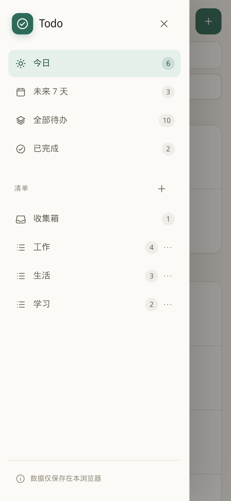 |
| 全屏任务详情 | 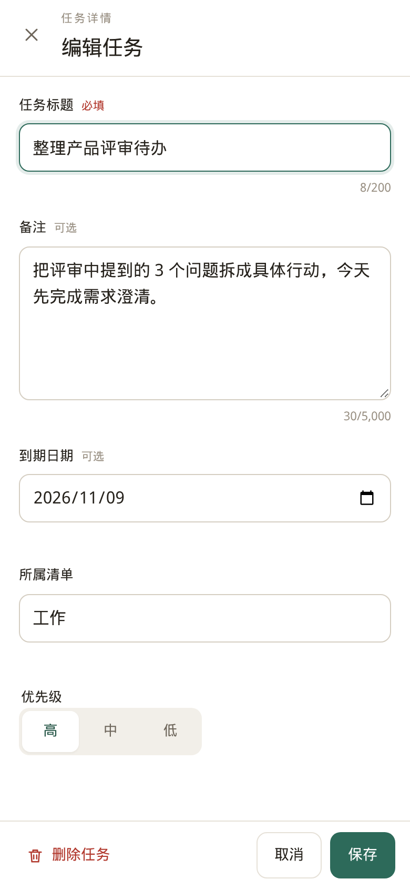 |

## 交互要点

- 桌面端：固定侧边导航 + 内容区；任务详情为右侧面板，保留背景上下文。
- 手机端（≤ 800px）：侧边导航收起为抽屉，任务详情全屏展示；主要点击区域不小于 44 × 44 CSS 像素；不依赖鼠标悬停显示操作。
- 今日 / 未来 7 天按分组展示；清单视图提供“待完成 / 已完成”页签。
- 任务详情采用显式保存 / 取消。存在未保存修改时，关闭、Esc 或点击遮罩都会先确认“放弃修改 / 继续编辑”。
- 弹窗使用原生 `dialog` 并补充焦点循环；打开后焦点进入标题或首个操作，关闭后返回触发入口。
- 所有用户输入按纯文本渲染；长标题、长链接和长清单名会换行，不会撑出页面。
